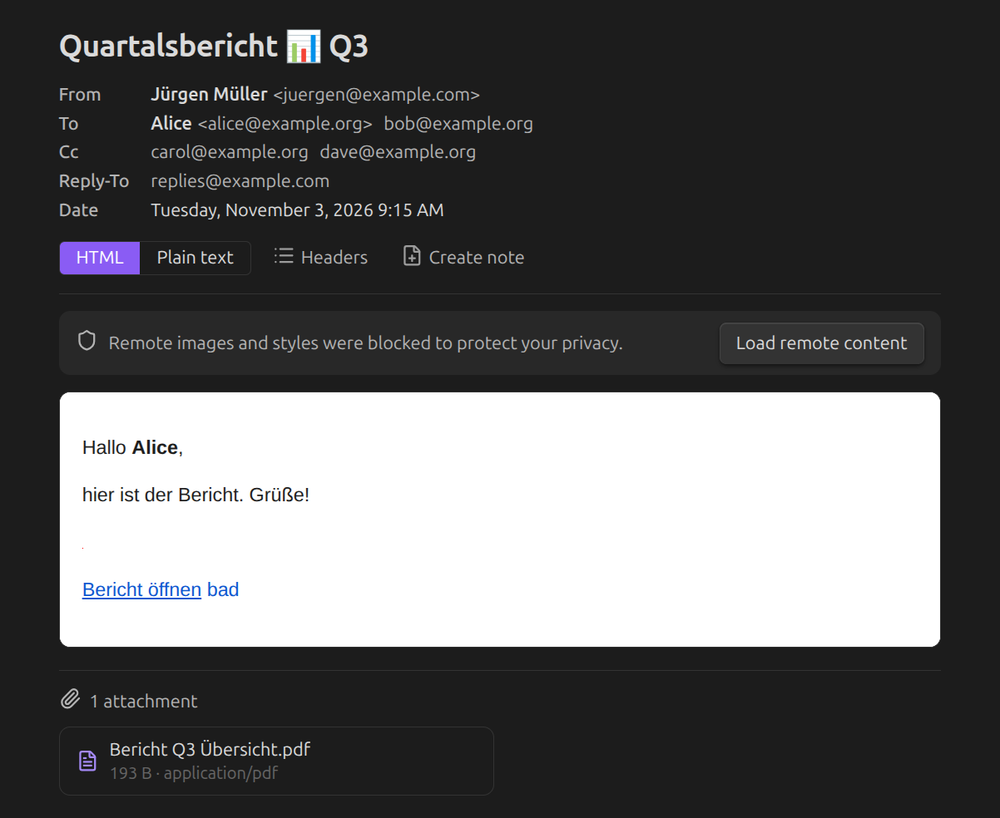

# Email Viewer for Obsidian

Open email files directly in Obsidian, the same way you open PDFs or Markdown notes.



| Format  | Source                                   |
| ------- | ---------------------------------------- |
| `.eml`  | Standard RFC 822 / MIME (Thunderbird, Gmail export, most clients) |
| `.emlx` | Apple Mail                               |
| `.mbox` | Mailbox archives (Google Takeout, Thunderbird); shows a filterable message list |
| `.msg`  | Microsoft Outlook                        |

## Features

- Header block with From / To / Cc / Bcc / Reply-To / Date. Click an address to copy it or write an email.
- HTML emails render in a sandboxed frame. Scripts, event handlers, `javascript:` links, meta refreshes and embedded frames are removed.
- **Remote content is blocked by default** (tracking pixels, remote CSS and fonts). Load it for a single message with one click, or turn blocking off in settings.
- Inline (`cid:`) images are shown in place.
- Switch between the HTML and plain-text versions, and view all raw headers.
- Attachments: open them (they're saved to your vault's attachment folder first), save them to the vault, or download them. Forwarded `.eml` and `.msg` attachments open in the viewer too.
- **Create note from email**: makes a Markdown note with `subject`, `from`, `to`, `cc`, `date`, `attachments` and a `source` link as properties, and the body converted to Markdown. Available from the view toolbar, the command palette and the file context menu.
- The view reloads automatically when the file changes on disk.
- Works on mobile (no Node.js dependencies).

## Install

In Obsidian, open *Settings → Community plugins → Browse*, search for **Email Viewer**, then install and enable it.

To install manually, download `main.js`, `manifest.json` and `styles.css` from the [latest release](https://github.com/maximilian-schwaerzler/obsidian-email-viewer/releases/latest) into `<vault>/.obsidian/plugins/email-viewer/`, then enable **Email Viewer** under *Settings → Community plugins*.

## Privacy

The plugin makes no network requests of its own and collects no data. Remote images in emails are blocked unless you choose to load them for a message, or turn blocking off in settings.

## Development

```bash
npm install
npm run dev     # rebuild on change
npm test        # parser tests against fixtures in test/fixtures
npm run lint    # Obsidian's review rules (eslint-plugin-obsidianmd)
```

To release: `npm version patch` (or `minor`/`major`) updates `manifest.json` and `versions.json`, then `git push --follow-tags`. The GitHub workflow builds the plugin and publishes the release.

- `src/parse.ts`: turns every format into one `ParsedEmail` model (postal-mime for MIME, @kenjiuno/msgreader for Outlook). It has no Obsidian dependency.
- `src/html.ts`: sanitises the HTML, applies the CSP, resolves `cid:` images and detects remote content.
- `src/view.ts`: the `FileView` (message rendering, mbox list, attachments).
- `src/main.ts`: plugin registration, commands, Create note.
- `src/shims/iconv-lite.ts`: a small TextDecoder-based replacement for iconv-lite. It keeps the bundle small (~175 KB) and mobile-compatible.

The sample `.msg` files in `test/fixtures` come from the test suite of [msgreader](https://github.com/HiraokaHyperTools/msgreader).
